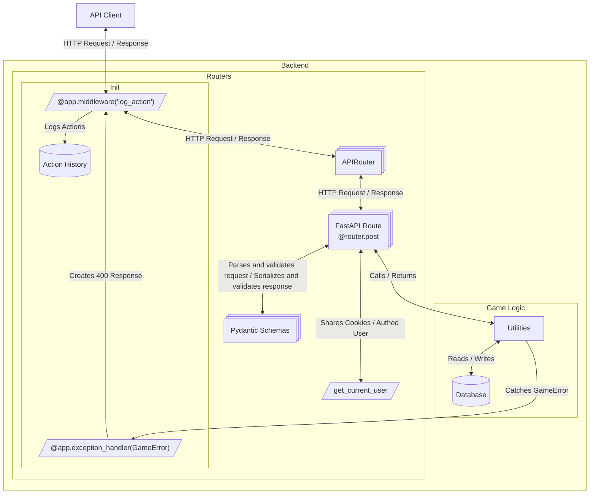

# Overview of API

APIs are defined in the backed using FastAPI + Pydantic. See `<URL>/docs` for Swagger docs and `<URL>/openapi.json` for an OpenAPI compliant definition of the HTTP APIs. On the frontend, requests are managed by Tanstack Query. Each backend app's OpenAPI schema is used to generate that app's TypeScript types (see [Type Generation](#type-generation)). Furthermore, since data regularly becomes stale, invalidation messages are sent using Socket.IO. See the [Real-time Synchronisation](real-time-sync.md) for more details.

Note that there is an intention for players to be able to use the API themselves directly. Hence swagger.

## Design: AIP-136

APIs use AIP-136 style syntax, .i.e. POST requests with a verb, e.g. in energetica/freeplay/routers/resource_market.py:

Use POST with verb suffixes for actions:

```py
@router.post("/asks/{ask_id}:purchase")
@router.post("/facilities/{facility_id}:start")
```

## Backend patterns

See routers/ see schemas/
See middleware, it does logging mechanism + checks auth
In a route, you have `depends` to get a player and the middleware does the checks. There's a specific file where that's defined.
See auth.md

## Frontend patterns

Each app with a backend has its own generated types in `src/types/api.generated.ts`, read through the `api-helpers.ts` beside it (see [Type Generation](#type-generation)). See hooks.

See api_integration for more details.

#### Type Generation

After modifying backend API schemas or routes, regenerate TypeScript types:

```bash
cd frontend
bun generate-types
```

This script:

1. Generates an OpenAPI spec from each FastAPI app (freeplay, Workshop and the lobby). The backend doesn't need to be running.
2. Creates one TypeScript types file per app: `frontend/apps/freeplay/src/types/api.generated.ts`, the Workshop's `frontend/apps/workshop/src/types/api.generated.ts` and the lobby's `frontend/apps/lobby/src/types/api.generated.ts`. Prettier leaves these files as generated (see `.prettierignore`).

Each per-app file lists only the routes that app serves. Each app imports only its own file, through the `api-helpers.ts` beside it, so no app can type-check against a route its backend does not serve. Shared packages, such as `@energetica/instance`, import the types of whichever app compiles them through the `@api` alias (see [the overview](overview.md#frontend)).

**Note:** Don't edit the generated files manually.

## Error handling

see the dedicated file about this

## API Flow

This below is very complicated. Once the above is fleshed out, this can be simplified or removed.

There are multiple components involved in processing an API request. Largely this is a standard FastAPI flow, with middleware, routers, and schemas working together to handle requests and responses. Of note is the custom middleware for logging actions, and the error handling middleware.


