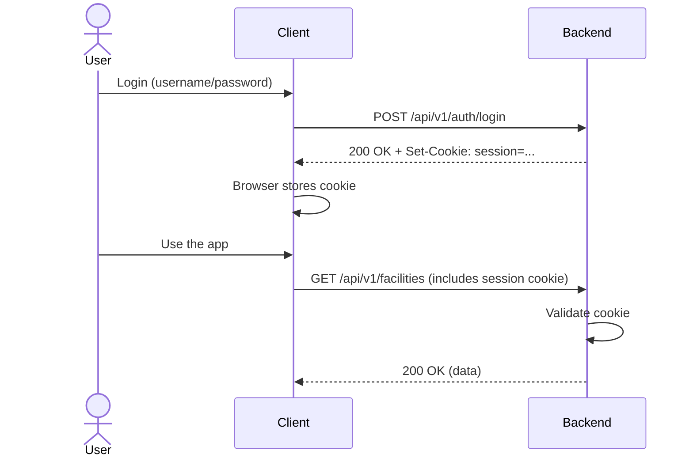

# Authentication

Energetica uses cookie-based session authentication. All API endpoints are RESTful—pass your session cookie along and you're authenticated.

## How It Works



## Using the API

To authenticate via API:

1. **Login** - `POST /api/v1/auth/login`
   - Send: `{"username": "...", "password": "..."}`
   - Get back: `Set-Cookie: session=<token>`

2. **Use the cookie** - Include it in all subsequent requests
   - Browsers do this automatically
   - API clients: set `credentials: "include"` (fetch) or similar

3. **Check auth** - `GET /api/v1/auth/me`
   - Returns current user if authenticated
   - Returns 401 if not

## Backend Implementation

**Entry point:** `energetica/freeplay/routers/auth.py`

- `POST /auth/login` - Validates credentials, sets session cookie
- `GET /auth/me` - Returns current user
- `POST /auth/signup` - Creates new account
- `POST /auth/change-password` - Changes password

**Entry gate:** `resolve_entry_account` in `energetica/identity/web.py` checks the session cookie
and this instance's access policy. The persistent world's `GET /auth/me` and Workshop's
`POST /workshop/enter` both depend on it, so the two kinds of Run admit the same accounts.

**Session management:** `energetica/kernel/session.py`

- `add_session_cookie_to_response()` - Sets the session cookie on responses
- Session tokens are signed using `itsdangerous` serializer

**Middleware:** `energetica/freeplay/routers/__init__.py`

- The API only ever speaks JSON — it never issues browser redirects. An unauthenticated request returns a `401` (JSON) from the endpoint; the SPA owns the redirect to `/app/login` client-side (`frontend/apps/freeplay/src/routes/__root.tsx`, driven by `/auth/me`). After the Phase 5 cutover FastAPI serves no HTML, so a server-side redirect could only land a `fetch` client on Apache's (or, in dev, Vite's) `index.html` — the `Unexpected token '<', "<!DOCTYPE"...` break.
- POST/PUT/PATCH/DELETE requests require authentication (enforced per-endpoint)

**Authentication enforcement:** Endpoints use FastAPI `Depends()` to require authentication.
The account and role checks live in `energetica/identity/web.py`, so every game mode can use them.
The checks that need the persistent world live in `energetica/freeplay/utils/auth.py`.

```
get_current_account()   - Returns the Account or None            (identity/web.py)
get_playing_account()   - Requires an account with the "player" role  (identity/web.py)
get_facilitator()       - Requires an account with the "facilitator" role  (identity/web.py)
get_settled_player()    - Requires a player who has chosen a location  (freeplay/utils/auth.py)
```

## Frontend Implementation

**Auth state:** `frontend/apps/freeplay/src/contexts/auth-context.tsx`

- Manages global auth state (user, isAuthenticated, isLoading)
- Fetches `/auth/me` on app startup
- Handles 401 errors gracefully (user not authenticated)

**In a Workshop Run** the Workshop's own app (`frontend/apps/workshop`) enters through
`POST /api/v1/workshop/enter` instead of `/auth/me`, which the Workshop backend does not serve. The
gate is the pathless `_entered` route (`frontend/apps/workshop/src/routes/_entered.tsx`), in front
of every page of the Run. As with `/auth/me`, a 401 or a denied account sends the visitor to the
lobby. The join page and the facilitator pages sit outside the gate: a visitor on the join page has
not been admitted yet, and the backend refuses the facilitator pages' calls to anyone but the
facilitator. Neither app asks the backend which Run mode it is in: each
Instance is served the app for its Run mode.

**Auth hook:** `frontend/apps/freeplay/src/hooks/use-auth.ts`

- Provides `user`, `isAuthenticated`, `isLoading`, `refetch()`, `logout()`
- Must be used within `AuthProvider`

**Protected routes:** `frontend/apps/freeplay/src/routes/__root.tsx`, with the rules in `frontend/apps/freeplay/src/lib/route-guard.ts`

- TODO: explain and fill in details in [routing.md](../frontend/routing.md)

**API client:** `frontend/packages/core/src/api-client.ts`

- Automatically includes cookies with all requests (`credentials: "include"`)

## Reverse Proxy / Deployment

When deployed behind a reverse proxy (e.g., Apache with SSL termination):

- The frontend receives HTTPS but backend receives HTTP from the proxy
- Backend checks the `X-Forwarded-Proto: https` header to determine if SSL is active upstream
- Session cookie is set with `secure=true` only when `X-Forwarded-Proto: https` is present
- This allows the same code to work in dev (HTTP) and production (HTTPS behind proxy)

See `energetica/kernel/session.py:add_session_cookie_to_response()` for implementation.
